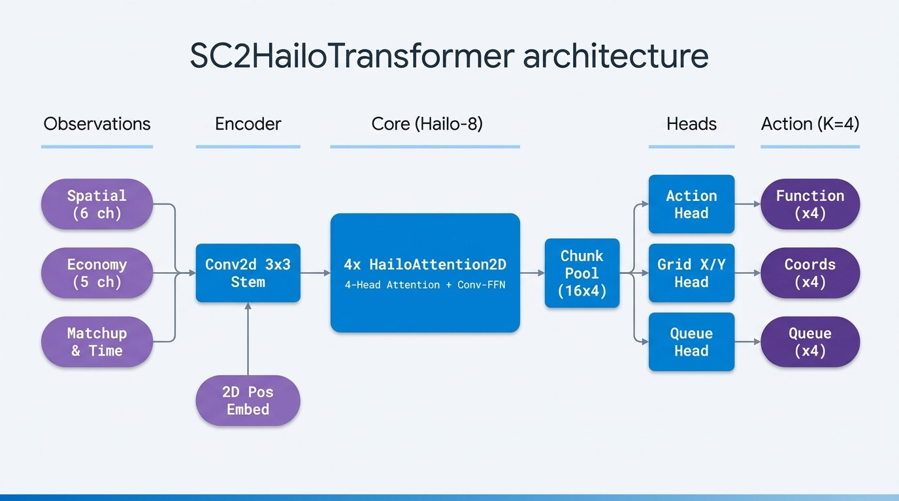
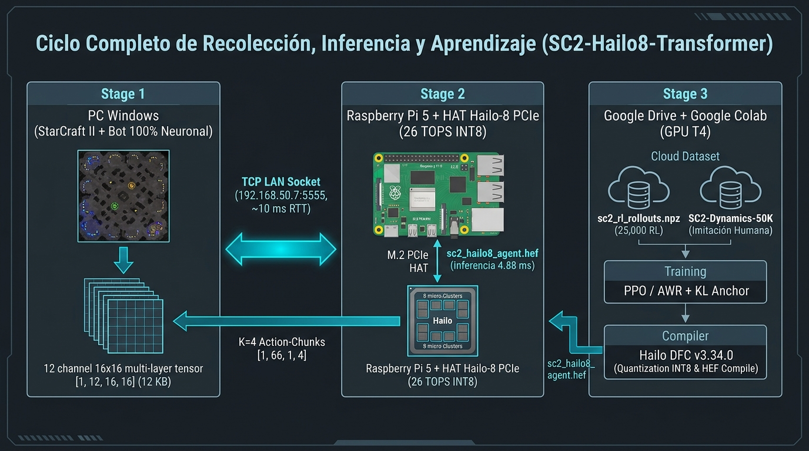
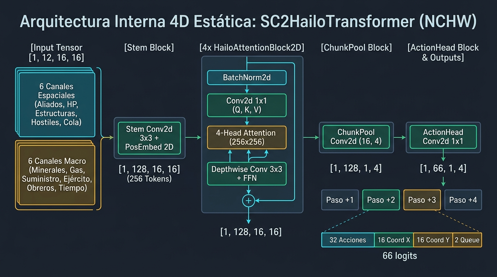
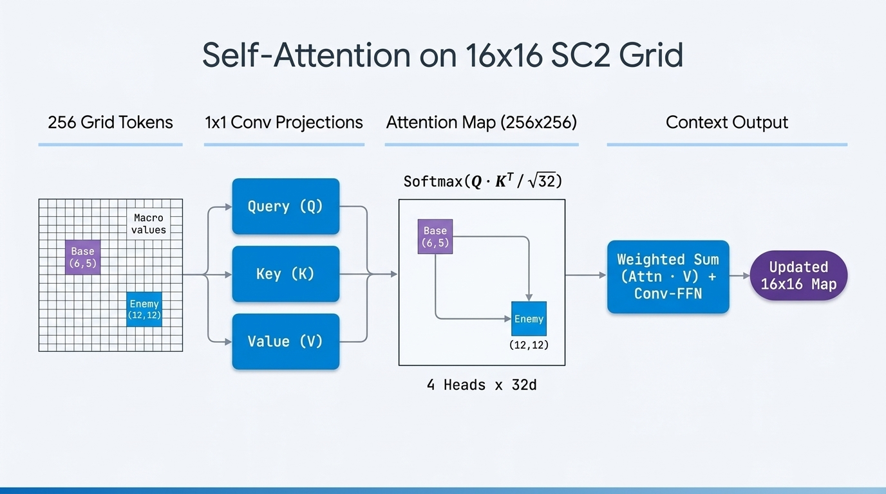

# 🧠 SC2-Hailo8-Transformer: Agente Transformer 100% Neuronal para StarCraft II en Raspberry Pi 5 + Hailo-8 NPU

[-00B4D8?style=for-the-badge)](https://hailo.ai/)
[-C51A4A?style=for-the-badge)](https://www.raspberrypi.com/)
[-FFB703?style=for-the-badge)](https://github.com/BurnySc2/python-sc2)
[](#entrenamiento-en-2-fases-imitación--actor-critic-ppo-rl)
[-2EC4B6?style=for-the-badge)](#utilización-de-silicio-en-el-chip-hailo-8)

**`SC2-Hailo8-Transformer`** es un agente de **StarCraft II** impulsado **100% por una red neuronal Transformer** compilada en formato binario `.hef` para ejecutarse físicamente dentro del acelerador **Hailo-8 (26 TOPS INT8)** conectado por PCIe a una **Raspberry Pi 5**.

La Raspberry Pi 5 actúa como el **cerebro táctico y estratégico en red local (LAN)**, recibiendo el estado del mapa desde una PC con StarCraft II por socket TCP (`TCP_NODELAY`) y devolviendo **paquetes de $K=4$ órdenes futuras (*Action-Chunking*) en `~4.88 ms`**, sin una sola regla algorítmica ni corrección manual de coordenadas.



---

## ✨ Características Principales

- **🎯 Control 100% Neuronal (Cero Reglas Algorítmicas):**
  - El modelo decide de forma autónoma **qué acción ejecutar** (entre las 32 acciones macro/micro multi-raza) y **en qué coordenada espacial $(gx, gy)$ del mapa completo ($16 \times 16$)** aplicarla (construcciones, expansiones, exploración, ataque, retirada y habilidades).
- **⚡ Arquitectura 4D Estática (`NCHW`) Nativa para Hailo-8:**
  - Diseñada desde cero para el **Hailo Dataflow Compiler (DFC v3.34.0)**: reemplaza las capas `Linear` 3D, `LayerNorm` 1D y *Pointer Networks* dinámicas por convoluciones punto a punto `Conv2d(1×1)`, `BatchNorm2d` (fusionado en hardware a costo 0 ms), activaciones `ReLU` e interacciones de atención matricial estática $256 \times 256$.
  - Cabe íntegramente en **1 único contexto en la memoria SRAM interna del Hailo-8** (**0 cambios de contexto por PCIe**).
- **📦 Horizonte Predictivo con *Action-Chunking* ($K=4$):**
  - En lugar de predecir una sola orden por frame o depender de una LSTM recurrente lenta, el cabezal convolucional predice **4 pasos futuros coordinados en un solo disparo** (`[1, 66, 1, 4]`), amortizando la latencia de red LAN y permitiendo secuencias completas (*ej. entrenar trabajador $\rightarrow$ construir depósito $\rightarrow$ producir infantería $\rightarrow$ atacar*).
- **🏆 Aprendizaje Híbrido (Imitación Supervisada + Actor-Critic PPO con Ancla KL):**
  - **Fase 1 (Pre-entrenamiento Supervisado):** Aprendizaje sobre **30,000+ estados reales** del dataset [`yxzhang2024/SC2-Dynamics-50K`](https://huggingface.co/datasets/yxzhang2024/SC2-Dynamics-50K) con `WeightedRandomSampler` y `ClassBalancedFocalLoss` ($\gamma=2.0$).
  - **Fase 2 (Fine-Tuning por Refuerzo Actor-Critic):** Recolección automática de partidas reales contra la IA de StarCraft II (`--collect-rl`), evaluadas por una **Red Crítica de Valor $V_\phi(s_t)$** en GPU para estimar ventajas por estado $\hat{A}_t = G_t - V_\phi(s_t)$ junto con una penalización de divergencia $\text{KL}(\pi_\theta \parallel \pi_{\text{ref}})$ estilo **AlphaStar**.

---

## 🌐 Pipeline Distribuido en Tiempo Real (PC $\leftrightarrow$ LAN $\leftrightarrow$ Raspberry Pi 5 + Hailo-8)



1. **Extracción del Estado (`src/pc_sc2_client.py`):**
   - La PC lee el estado de la partida en vivo desde la API de StarCraft II y construye un tensor compacto `float32` de forma **`[1, 12, 16, 16]`** (`3,072` flotantes = **`12 KB`**).
2. **Transmisión LAN (`TCP_NODELAY`):**
   - Se envía por socket TCP persistente a la Raspberry Pi 5 (`puerto 5555`) con latencia de red local de `~1–2 ms`.
3. **Inferencia INT8 en el HAT Hailo-8 (`src/rpi_hailo_server.py`):**
   - El motor `Hailo8InferenceEngine` inyecta el tensor al flujo DMA PCIe del chip **Hailo-8**, evalúa los 4 bloques Transformer en **`~4.88 ms`** y decodifica el tensor de salida **`[1, 66, 1, 4]`**.
4. **Ejecución Directa 1-a-1 en StarCraft II:**
   - El cliente PC encola las $K=4$ decisiones devueltas por la NPU y las ejecuta paso a paso proyectando $(gx, gy) \in [0..15]^2$ directamente sobre las dimensiones totales del mapa (`grid_to_point2`).

---

## 🔬 Arquitectura Interna del Modelo (`SC2HailoTransformer`)



### 1. Tensor de Entrada: `[1, 12, 16, 16]`
El mapa completo de StarCraft II se divide en una cuadrícula de **$16 \times 16 = 256$ sectores espaciales (*tokens*)**, donde cada celda contiene **12 canales normalizados en $[0.0, 1.0]$**:

| Canal | Nombre | Descripción |
| :---: | :--- | :--- |
| **`0`** | `My Units Density` | Densidad de escuadrones y unidades aliadas en cada celda $(gx, gy)$. |
| **`1`** | `My Units Health` | Fracción de vida promedio (`HP %`) de las unidades aliadas en esa celda. |
| **`2`** | `My Structures` | Presencia de centros de mando, barracones, fábricas y defensas propias. |
| **`3`** | `Enemy Units & Structures` | Densidad de tropas y edificios enemigos visibles en la celda. |
| **`4`** | `Enemy Health` | Fracción de vida promedio (`HP %`) de las fuerzas enemigas en la celda. |
| **`5`** | `Production Queue Load` | Nivel de ocupación de las colas de producción activas. |
| **`6`** | `Minerals` | Minerales disponibles normalizados (`/ 2000.0`). |
| **`7`** | `Vespene Gas` | Gas vespeno disponible normalizado (`/ 1500.0`). |
| **`8`** | `Total Supply Used` | Suministro total utilizado (`/ 200.0`). |
| **`9`** | `Army Supply` | Suministro militar activo (`/ 120.0`). |
| **`10`** | `Worker Supply` | Cantidad de trabajadores activos (`/ 90.0`). |
| **`11`** | `Game Context Bands` | Bandas de contexto global: tiempo de partida (`0:4`), tasa de recolección (`4:8`), raza propia (`8:12`) y raza enemiga (`12:16`). |

---

### 2. Mecanismo de *Multi-Head Self-Attention* Espacial ($256 \times 256$)



Dentro de cada uno de los **4 bloques `HailoAttentionBlock2D`** (`d_model = 128`, `n_heads = 4`, `head_dim = 32`):
1. **Proyecciones 4D ($Q, K, V$):** Tres capas `Conv2d(128, 128, kernel_size=1)` generan *Queries*, *Keys* y *Values* para las 256 celdas en paralelo.
2. **Matriz de Atención Global ($256 \times 256$ por cabeza):**
   $$\text{Attention}(Q, K, V) = \text{Softmax}\left(\frac{Q \cdot K^T}{\sqrt{32}}\right) V$$
   Permite que cualquier celda del mapa (por ejemplo, tu base en `(3, 4)`) consulte instantáneamente el estado de cualquier otra celda distante (como una expansión libre en `(12, 3)` o el ejército enemigo en `(13, 12)`).
3. **Bloque *Conv-FFN* Espacial:** Un *Inverted Bottleneck* (`Conv2d 1×1` $\rightarrow$ `Depthwise Conv2d 3×3` $\rightarrow$ `Conv2d 1×1` con conexiones residuales y `BatchNorm2d + ReLU`) refina el contexto local vecinal de cada sector.

---

### 3. Tensor de Salida (*Action-Chunking*): `[1, 66, 1, 4]`
La capa `chunk_pool` (`Conv2d` con `kernel=(16, 4)` y `stride=(16, 4)`) junto con `action_head` (`Conv2d 1×1`) produce **4 columnas temporales** ($t+1, t+2, t+3, t+4$), cada una con **66 *logits***:
- **`Logits [0 : 32]` (`action_id`):** Qué acción ejecutar dentro del vocabulario táctico/estratégico de 32 acciones.
- **`Logits [32 : 48]` (`target_x`):** Coordenada horizontal $gx \in [0..15]$ en el mapa.
- **`Logits [48 : 64]` (`target_y`):** Coordenada vertical $gy \in [0..15]$ en el mapa.
- **`Logits [64 : 66]` (`queue_flag`):** Ejecución inmediata (`False`) o encolada con Shift (`True`).

---

## ⚖️ Comparación Técnica con DeepMind AlphaStar

| Característica | DeepMind AlphaStar | `SC2-Hailo8-Transformer` (Este Proyecto) |
| :--- | :--- | :--- |
| **Hardware de Inferencia** | Clúster Cloud TPU v3 / GPU (16–150 W) | **Raspberry Pi 5 + HAT Hailo-8 NPU (`~3.5 W`)** |
| **Tamaño del Modelo** | `~139,000,000` parámetros (`FP32/BF16`) | **`~850,000` parámetros (`INT8` cuantizado)** |
| **Representación Espacial** | Malla $128 \times 128$ + lista variable de hasta 512 unidades | **Malla unificada $16 \times 16 \times 12$ (`100% NCHW 4D estática`)** |
| **Mecanismo de Memoria** | `Deep LSTM` recurrente | **Horizonte *Action-Chunking* ($K=4$ órdenes por inferencia)** |
| **Selección de Coordenadas** | *Pointer Network* + deconvolución $128 \times 128$ | **Cabezales desacoplados `target_x (16)` + `target_y (16)`** |
| **Funciones de Activación / Norm** | `GELU` / `ReLU` + `LayerNorm` 1D | **`ReLU` + `BatchNorm2d` (fusionado en hardware a 0 ciclos)** |
| **Latencia por Inferencia** | `~25 – 50 ms` en GPU | **`~4.88 ms` en Hailo-8 (`~1.22 ms` por acción del chunk)** |

---

## 📊 Utilización de Silicio en el Chip Hailo-8

Al compilar con **Hailo Dataflow Compiler v3.34.0**, el grafo completo se aloja en **un único contexto físico (`Single-Context`)** dentro de los 8 clústeres del chip:

| Recurso Físico del Hailo-8 | Uso de `SC2HailoTransformer` | Estado |
| :--- | :---: | :--- |
| **Contextos de Ejecución** | **`1 / 1` (Single-Context)** | ✅ Sin *context-switching* por PCIe |
| **Control Units** | **`75.0%`** | ✅ Dentro del límite de 1 contexto |
| **Compute (MACs INT8)** | **`43.0%`** | ✅ Amplio margen térmico |
| **On-Chip SRAM Memory** | **`48.2%`** (`49 / 102` buffers) | ✅ 100% de pesos residentes en SRAM |

---

## 🔄 Entrenamiento en 2 Fases: Imitación + Actor-Critic PPO RL

1. **Fase 1 — Imitación Supervisada Balanceada (`Celdas 1–6` del Notebook):**
   - Entrena sobre `SC2-Dynamics-50K` aplicando `WeightedRandomSampler` por `(Raza × Acción)` y `ClassBalancedFocalLoss` para que las acciones raras de combate y tecnología reciban hasta `15x` más gradiente que la recolección básica.
2. **Fase 2 — Aprendizaje por Refuerzo Actor-Critic PPO (`entrenar_rl_hailo8.bat` + `Celda 1-Botón`):**
   - **En la PC:** `entrenar_rl_hailo8.bat` corre tandas de 30 partidas aceleradas con un supervisor *anti-hang* y currículum automático (`Easy` $\rightarrow$ `Medium` $\rightarrow$ `Hard` $\rightarrow$ `VeryHard` al superar el `60%` de victorias recientes), guardando estados, acciones y retornos descontados $G_t$ ($\gamma = 0.97$) en `sc2_rl_rollouts.npz`.
   - **En Google Colab (Modo 1-Botón):** La última celda del notebook entrena primero una **Red Crítica de Valor $V_\phi(s_t)$ (`SC2ValueCritic`)** en GPU para estimar el retorno esperado de cada estado y calcular la ventaja Actor-Critic:
     $$\hat{A}_t = \frac{G_t - V_\phi(s_t)}{\text{std}(G_t - V_\phi(s_t)) + 10^{-6}}$$
   - Luego actualiza el **Actor `SC2HailoTransformer`** combinando los pesos exponenciales de ventaja con un **ancla supervisada humana del 25%** y una penalización **$\text{KL}(\pi_\theta \parallel \pi_{\text{ref}})$** ($\beta = 0.25$), exporta el `.onnx` estático (Opset 16) y compila automáticamente el nuevo `sc2_hailo8_agent.hef` sin reiniciar el kernel.

---

## 📁 Estructura del Repositorio

```text
sc2-hailo8-transformer/
├── docs/
│   └── images/                          # Diagramas de arquitectura, tensores 4D y Self-Attention
├── models/
│   ├── sc2_hailo8_agent.hef             # Binario compilado para la NPU Hailo-8 (Single-Context)
│   ├── sc2_hailo8_transformer.onnx      # Grafo ONNX estático (Opset 16)
│   ├── sc2_hailo8_transformer_best.pth  # Pesos PyTorch del Actor SC2HailoTransformer
│   └── sc2_value_critic.pth             # Pesos PyTorch de la Red Crítica V_phi(s_t)
├── notebooks/
│   └── SC2_Hailo8_Transformer.ipynb     # Notebook de Colab con Modo 1-Botón (RL + ONNX + .hef)
├── src/
│   ├── config.py                        # Vocabulario de 32 acciones y dimensiones estáticas
│   ├── dataset.py                       # Pipeline SC2-Dynamics-50K y balanceador estadístico
│   ├── model.py                         # Arquitectura SC2HailoTransformer y Focal Loss
│   ├── compile_hef.py                   # Script de traducción, calibración INT8 y compilación Hailo DFC
│   ├── rpi_hailo_server.py              # Servidor TCP en tiempo real para Raspberry Pi 5 + Hailo-8
│   └── pc_sc2_client.py                 # Cliente StarCraft II 100% neuronal + recolector RL
├── entrenar_rl_hailo8.bat               # Lanzador de recolección RL acelerada (30 partidas)
├── jugar_contra_ia_hailo8.bat           # Lanzador para jugar tú mismo (Humano) contra el Hailo-8
└── requirements.txt                     # Dependencias para PC y entorno de entrenamiento
```

---

## 🚀 Guía de Uso Rápido

### 1. En la Raspberry Pi 5 + HAT Hailo-8
Copia `src/rpi_hailo_server.py`, `src/config.py` y `models/sc2_hailo8_agent.hef` a la Raspberry Pi e inicia el servidor TCP:

```bash
python3 rpi_hailo_server.py --host 0.0.0.0 --port 5555 --hef sc2_hailo8_agent.hef
```

### 2. En la PC con Windows y StarCraft II
Instala las dependencias:

```powershell
pip install -r requirements.txt
```

- **Ver una partida en vivo del bot (100% IA Pura):**
  ```powershell
  py -3.12 -m src.pc_sc2_client --play --rpi-ip 192.168.50.7 --port 5555 --map Simple64 --race Terran --enemy-race Zerg --difficulty Medium --realtime
  ```
- **Jugar tú mismo (Humano) contra tu Raspberry Pi + Hailo-8:**
  Haz doble clic en `jugar_contra_ia_hailo8.bat` o ejecuta:
  ```powershell
  py -3.12 -m src.pc_sc2_client --play --human --rpi-ip 192.168.50.7 --port 5555 --map Simple64 --race Terran --enemy-race Zerg
  ```
- **Recolectar experiencia RL (30 partidas aceleradas con currículum automático):**
  Haz doble clic en `entrenar_rl_hailo8.bat` o ejecuta:
  ```powershell
  py -3.12 -u -m src.pc_sc2_client --collect-rl --episodes 30 --difficulty Medium --explore-eps 0.16 --rpi-ip 192.168.50.7 --port 5555
  ```

### 3. Fine-Tuning Actor-Critic y Compilación `.hef` en 1 Solo Botón (Google Colab)
1. Abre `notebooks/SC2_Hailo8_Transformer.ipynb` en Google Colab con GPU T4.
2. Ve directamente a la última celda (**`🚀 CELDA TODO-EN-UNO (1 SOLO BOTÓN)`**) y presiona **Play**.
3. Descarga o sincroniza el nuevo `sc2_hailo8_agent.hef` generado en Google Drive hacia la Raspberry Pi.
